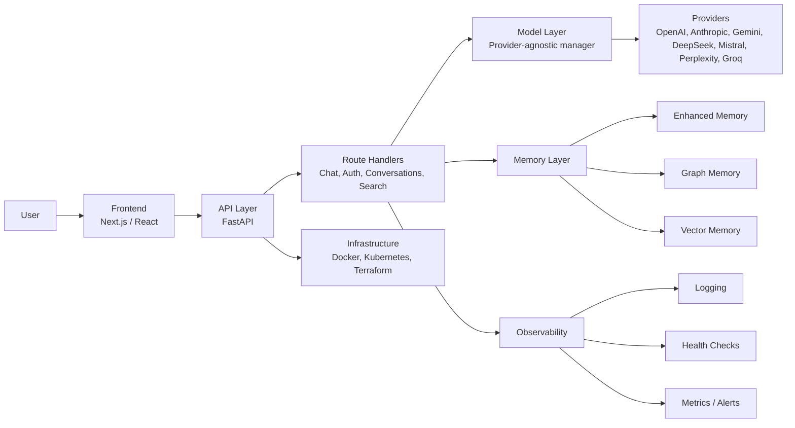

# Zakera Architecture

Zakera is a layered AI chat platform that combines a React-based frontend, a FastAPI backend, a provider-agnostic model layer, multiple memory strategies, and deployment infrastructure for local and cloud environments.

## High-level system diagram

## Component overview

### Frontend
- Built with Next.js and React
- Handles chat UX, message rendering, conversation history, and model selection
- Supports real-time updates through HTTP and WebSocket interactions

### API
- Built with FastAPI
- Exposes endpoints for chat, authentication, conversations, search, analytics, tools, and monitoring
- Applies middleware for CORS, request IDs, timing, health checks, and logging

### Model Layer
- Provider-agnostic manager that resolves and caches model providers
- Supports routing across hosted and local model backends
- Includes fallback behavior and provider health tracking

### Memory Layer
- Enhanced memory for richer conversation persistence
- Graph memory for relationship-aware context
- Vector memory for semantic retrieval and recall
- Used to preserve context across turns and sessions

### Infrastructure
- Docker for containerized development and deployment
- Kubernetes for orchestration and scaling
- Terraform for infrastructure provisioning
- Monitoring and alerting for operational visibility

## Request flow
1. A user sends a message from the frontend.
2. The frontend calls the FastAPI chat endpoint.
3. The API loads conversation state and memory context.
4. The model manager selects the appropriate provider.
5. The provider generates a response.
6. The API persists the result and returns it to the frontend.
7. Logging, health checks, and metrics capture system behavior.

## Design goals
- Keep model providers swappable
- Preserve conversation context
- Make the architecture easy to observe and operate
- Separate presentation, API, model, and memory concerns cleanly
- Support local development and scalable deployment paths
