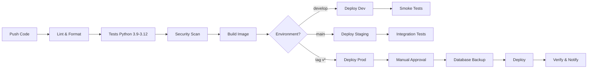

# Infrastructure & Deployment Guide

## 🎯 Complete Infrastructure Deployment for Zakera

Comprehensive guide for deploying Zakera AI Chat Agent with production-ready infrastructure, including Kubernetes, CI/CD, monitoring, and security.

---

## 📋 Table of Contents

1. [Overview](#overview)
2. [Architecture](#architecture)
3. [Prerequisites](#prerequisites)
4. [Quick Start](#quick-start)
5. [Kubernetes Deployment](#kubernetes-deployment)
6. [CI/CD Pipeline](#cicd-pipeline)
7. [Monitoring Setup](#monitoring-setup)
8. [Security Configuration](#security-configuration)
9. [Terraform Infrastructure](#terraform-infrastructure)
10. [Operations Guide](#operations-guide)
11. [Troubleshooting](#troubleshooting)

---

## 🏗️ Overview

### What's Included

**Kubernetes Resources:**
- ✅ Production deployment with 3+ replicas
- ✅ Horizontal Pod Autoscaler (3-20 replicas)
- ✅ Services and Ingress with TLS
- ✅ StatefulSets for Redis and PostgreSQL
- ✅ ConfigMaps and Secrets
- ✅ RBAC and Network Policies
- ✅ Pod Disruption Budget
- ✅ Istio service mesh integration

**CI/CD:**
- ✅ Multi-environment pipeline (dev/staging/prod)
- ✅ Automated testing and security scanning
- ✅ Docker image building and publishing
- ✅ Deployment with approval gates
- ✅ Slack notifications

**Monitoring:**
- ✅ Prometheus with 9 alert rules
- ✅ Grafana with custom dashboards
- ✅ Alertmanager for notifications
- ✅ ServiceMonitor for metrics collection

**Infrastructure as Code:**
- ✅ Terraform for AWS EKS
- ✅ VPC with multi-AZ setup
- ✅ Managed RDS PostgreSQL
- ✅ ElastiCache Redis cluster
- ✅ Auto-scaling node groups

**Automation:**
- ✅ Deployment script with validation
- ✅ Monitoring setup automation
- ✅ Health check script
- ✅ Rollback capability

---

## 🏛️ Architecture

### High-Level Architecture

```
┌─────────────────────────────────────────────────────┐
│                   Internet                          │
└────────────────┬────────────────────────────────────┘
                 │
┌────────────────▼────────────────────────────────────┐
│     Load Balancer / Ingress Controller             │
│     - TLS Termination                               │
│     - Rate Limiting                                 │
│     - DDoS Protection                               │
└────────────────┬────────────────────────────────────┘
                 │
┌────────────────▼────────────────────────────────────┐
│          Istio Service Mesh                         │
│     - Traffic Management                            │
│     - mTLS                                          │
│     - Circuit Breaking                              │
└────────────────┬────────────────────────────────────┘
                 │
       ┌─────────┴──────────┬──────────────┐
       │                    │              │
┌──────▼───────┐  ┌────────▼────┐  ┌─────▼──────┐
│ Zakera API   │  │   Redis     │  │ PostgreSQL │
│ (3-20 pods)  │  │ (3 replicas)│  │ (HA Setup) │
│ - FastAPI    │  │ - Cache     │  │ - Primary  │
│ - Auto-scale │  │ - Sessions  │  │ - Replicas │
└──────┬───────┘  └─────────────┘  └────────────┘
       │
       │
┌──────▼──────────────────────────────────────────────┐
│            Monitoring & Observability               │
│  - Prometheus (Metrics)                             │
│  - Grafana (Visualization)                          │
│  - Jaeger (Distributed Tracing)                     │
│  - Alertmanager (Notifications)                     │
└─────────────────────────────────────────────────────┘
```

### Component Details

**Frontend Tier:**
- Nginx Ingress Controller
- TLS termination
- Rate limiting (100 RPS)
- CORS handling

**Application Tier:**
- Zakera API pods (3-20 replicas)
- HPA based on CPU/memory/requests
- Rolling updates (max 1 surge, 0 unavailable)
- Pod anti-affinity for HA

**Data Tier:**
- PostgreSQL (RDS or StatefulSet)
- Redis cluster (3 replicas)
- Persistent volumes (SSD backed)

**Service Mesh:**
- Istio for traffic management
- mTLS between services
- Circuit breaker patterns
- Canary deployments ready

**Monitoring:**
- Prometheus for metrics
- Grafana for dashboards
- Alertmanager for alerts
- Jaeger for tracing

---

## 🔧 Prerequisites

### Required Tools

```bash
# Kubernetes CLI
brew install kubernetes-cli

# Helm package manager
brew install helm

# Terraform (for IaC)
brew install terraform

# AWS CLI (if using AWS)
brew install awscli

# Optional but recommended
brew install k9s            # Kubernetes TUI
brew install kubectx        # Context switching
brew install stern          # Multi-pod logs
```

### Required Access

- ✅ Kubernetes cluster (EKS, GKE, AKS, or self-hosted)
- ✅ Container registry access (GHCR, ECR, GCR)
- ✅ DNS management (Route53, CloudFlare)
- ✅ Certificate management (cert-manager)
- ✅ Secret management (Vault, AWS Secrets Manager)

### Required Secrets

Create these secrets before deployment:
- Database credentials
- Redis password
- JWT secret key
- AI provider API keys
- Alerting credentials

---

## 🚀 Quick Start

### 1-Command Deployment

```bash
# Deploy everything
./scripts/deploy-kubernetes.sh production

# With options
./scripts/deploy-kubernetes.sh production \
  --dry-run \
  --skip-tests
```

### Step-by-Step Deployment

```bash
# 1. Create namespace
kubectl create namespace zakera-production

# 2. Create secrets
kubectl create secret generic zakera-secrets \
  --from-env-file=.env.production \
  -n zakera-production

# 3. Deploy infrastructure (database, cache)
kubectl apply -f kubernetes/production/statefulsets.yaml

# 4. Deploy application
kubectl apply -f kubernetes/production/

# 5. Verify
kubectl get all -n zakera-production

# 6. Check health
./scripts/health-check.sh production
```

---

## ☸️ Kubernetes Deployment

### Deployment Strategy

**Rolling Update:**
- Max surge: 1 pod
- Max unavailable: 0 pods
- Zero-downtime deployments

**Blue-Green (using Istio):**
```bash
# Deploy new version as 'green'
kubectl apply -f kubernetes/production/deployment-green.yaml

# Test green deployment
curl -H "version: green" https://api.zakera.ai/health

# Switch traffic (in VirtualService)
# Change weights: blue: 0%, green: 100%

# Decommission blue
kubectl delete -f kubernetes/production/deployment-blue.yaml
```

**Canary (using Istio):**
```yaml
# In VirtualService
http:
- match:
  - headers:
      canary:
        exact: "true"
  route:
  - destination:
      host: zakera-api-service
      subset: canary
- route:
  - destination:
      host: zakera-api-service
      subset: v1
    weight: 95
  - destination:
      host: zakera-api-service
      subset: canary
    weight: 5
```

### Auto-Scaling Configuration

**HPA Metrics:**
```yaml
metrics:
- type: Resource
  resource:
    name: cpu
    target:
      type: Utilization
      averageUtilization: 70
- type: Resource
  resource:
    name: memory
    target:
      type: Utilization
      averageUtilization: 80
- type: Pods
  pods:
    metric:
      name: http_requests_per_second
    target:
      type: AverageValue
      averageValue: "1000"
```

**Testing HPA:**
```bash
# Watch HPA in action
kubectl get hpa -n zakera-production --watch

# Generate load
kubectl run load-test --image=williamyeh/hey -- \
  -z 60s -c 50 http://zakera-api-service/api/v1/health

# View pod count
kubectl get pods -l app=zakera -n zakera-production
```

### Resource Management

**Per-Pod Resources:**
- CPU: 500m request, 2000m limit
- Memory: 512Mi request, 2Gi limit

**Namespace Quotas:**
- CPU: 100 cores total
- Memory: 200Gi total
- Pods: 100 max

**Storage:**
- Redis: 10Gi per replica (SSD)
- PostgreSQL: 50Gi (SSD, expandable)

---

## 🔄 CI/CD Pipeline

### Workflow Overview



### Environments

| Environment | Branch | Auto-Deploy | Approval | Tests |
|-------------|--------|-------------|----------|-------|
| Development | develop | ✅ Yes | ❌ No | Smoke |
| Staging | main | ✅ Yes | ❌ No | Integration + Perf |
| Production | tags/v* | ❌ No | ✅ Yes | Smoke + Verify |

### Triggering Deployments

**Automatic:**
```bash
# Deploy to dev
git push origin develop

# Deploy to staging
git push origin main

# Deploy to production
git tag v1.0.0
git push origin v1.0.0
```

**Manual:**
```bash
# Via GitHub CLI
gh workflow run ci-cd-multi-env.yml \
  -f environment=production \
  -f skip_tests=false

# Via GitHub UI
# Actions → ci-cd-multi-env.yml → Run workflow
```

### Secrets Configuration

Add these secrets to GitHub repository:
- `KUBE_CONFIG` - Kubernetes config for kubectl
- `GITHUB_TOKEN` - Automatic
- `SLACK_WEBHOOK_URL` - Slack notifications
- `CODECOV_TOKEN` - Code coverage

---

## 📊 Monitoring Setup

### Quick Setup

```bash
# Install monitoring stack
./scripts/setup-monitoring.sh

# With options
./scripts/setup-monitoring.sh \
  --namespace monitoring \
  --import-dashboards
```

### Manual Setup

**1. Install Prometheus:**
```bash
helm repo add prometheus-community \
  https://prometheus-community.github.io/helm-charts

helm install prometheus prometheus-community/prometheus \
  -n monitoring \
  --create-namespace \
  -f monitoring/prometheus/values.yaml
```

**2. Install Grafana:**
```bash
helm repo add grafana https://grafana.github.io/helm-charts

helm install grafana grafana/grafana \
  -n monitoring \
  -f monitoring/grafana/values.yaml
```

**3. Configure Prometheus:**
```bash
kubectl apply -f monitoring/prometheus/prometheus-config.yaml
```

**4. Import Dashboards:**
```bash
# Grafana will auto-import from ConfigMap
kubectl create configmap grafana-dashboards \
  --from-file=monitoring/grafana/dashboards/ \
  -n monitoring
```

### Access Monitoring

```bash
# Prometheus
kubectl port-forward -n monitoring svc/prometheus-server 9090:80
open http://localhost:9090

# Grafana
kubectl port-forward -n monitoring svc/grafana 3000:80
open http://localhost:3000

# Alertmanager
kubectl port-forward -n monitoring svc/prometheus-alertmanager 9093:80
open http://localhost:9093
```

### Custom Metrics

**Application metrics exposed:**
- `http_requests_total` - Total HTTP requests
- `http_request_duration_seconds` - Request duration histogram
- `ai_model_requests_total` - AI model usage by provider
- `ai_tokens_used_total` - Token consumption
- `ai_cost_usd_total` - Cost tracking
- `redis_cache_hit_ratio` - Cache performance

---

## 🔒 Security Configuration

### 1. Enable RBAC

```bash
# Already configured in rbac-security.yaml
kubectl apply -f kubernetes/production/rbac-security.yaml
```

**Permissions granted:**
- Read ConfigMaps
- Read Secrets
- List Pods
- Service discovery

**Permissions denied:**
- Create/delete resources
- Cluster admin
- Privileged operations

### 2. Network Policies

```bash
# Apply network policies
kubectl apply -f kubernetes/production/rbac-security.yaml

# Verify
kubectl get networkpolicy -n zakera-production
kubectl describe networkpolicy zakera-api-network-policy -n zakera-production
```

**Traffic allowed:**
- Ingress: From ingress-controller, monitoring, same namespace
- Egress: To DNS, PostgreSQL, Redis, External APIs (443)

**Traffic blocked:**
- All other ingress
- Unnecessary egress

### 3. Pod Security Standards

```bash
# Enforce restricted policy
kubectl label namespace zakera-production \
  pod-security.kubernetes.io/enforce=restricted
```

**Enforced standards:**
- Run as non-root
- Read-only root filesystem
- No privilege escalation
- Drop all capabilities
- Seccomp profile

### 4. Secrets Management

**Best Practice: Use External Secrets**

```bash
# Install External Secrets Operator
helm repo add external-secrets https://charts.external-secrets.io
helm install external-secrets external-secrets/external-secrets \
  -n external-secrets-system \
  --create-namespace

# Configure AWS Secrets Manager
kubectl apply -f - <<EOF
apiVersion: external-secrets.io/v1beta1
kind: SecretStore
metadata:
  name: aws-secrets-manager
  namespace: zakera-production
spec:
  provider:
    aws:
      service: SecretsManager
      region: us-east-1
      auth:
        jwt:
          serviceAccountRef:
            name: external-secrets-sa
EOF
```

---

## 🌍 Terraform Infrastructure

### AWS EKS Deployment

**1. Configure Terraform:**
```bash
cd terraform/aws

# Create terraform.tfvars
cat > terraform.tfvars <<EOF
aws_region = "us-east-1"
environment = "production"
db_password = "secure-password"
redis_auth_token = "secure-token"
EOF
```

**2. Initialize and Plan:**
```bash
terraform init
terraform plan -out=tfplan
```

**3. Apply Infrastructure:**
```bash
terraform apply tfplan

# Get outputs
terraform output cluster_endpoint
terraform output configure_kubectl
```

**4. Configure kubectl:**
```bash
# Use output command
aws eks update-kubeconfig \
  --region us-east-1 \
  --name zakera-production
```

### What Terraform Creates

**Networking:**
- VPC with 3 AZs
- Public subnets (3)
- Private subnets (3)
- NAT gateways (3)
- Internet gateway
- Route tables
- VPC flow logs

**Compute:**
- EKS cluster (1.28)
- General node group (t3.xlarge, 3-10 nodes)
- Compute node group (c5.2xlarge, 2-20 nodes)
- Auto-scaling enabled

**Data:**
- RDS PostgreSQL (Multi-AZ, encrypted)
- ElastiCache Redis (3-node cluster)
- Automated backups
- Performance Insights

**Security:**
- Security groups
- IAM roles
- Encryption at rest
- Encryption in transit

---

## 🛠️ Operations Guide

### Daily Operations

**Check System Health:**
```bash
# Automated health check
./scripts/health-check.sh production

# Manual checks
kubectl get pods -n zakera-production
kubectl top pods -n zakera-production
kubectl get hpa -n zakera-production
```

**View Logs:**
```bash
# Real-time logs
kubectl logs -f deployment/zakera-api -n zakera-production

# Last 100 lines from all pods
kubectl logs --tail=100 -l app=zakera -n zakera-production

# Export logs
kubectl logs -l app=zakera -n zakera-production > zakera-logs.txt
```

**Metrics and Monitoring:**
```bash
# Access Grafana
kubectl port-forward -n monitoring svc/grafana 3000:80

# Check metrics endpoint
kubectl port-forward -n zakera-production svc/zakera-api-service 8000:80
curl http://localhost:8000/metrics
```

### Deployment Operations

**Deploy New Version:**
```bash
# Using automation script
./scripts/deploy-kubernetes.sh production

# Manual
kubectl set image deployment/zakera-api \
  api=ghcr.io/itsmepraks/zakera:v1.1.0 \
  -n zakera-production

kubectl rollout status deployment/zakera-api -n zakera-production
```

**Rollback:**
```bash
# Rollback to previous
./scripts/deploy-kubernetes.sh production --rollback

# Or manually
kubectl rollout undo deployment/zakera-api -n zakera-production
```

**Scale Manually:**
```bash
# Scale to specific count
kubectl scale deployment/zakera-api --replicas=10 -n zakera-production

# HPA will override this, so disable HPA first if needed
kubectl patch hpa zakera-api-hpa -n zakera-production \
  -p '{"spec":{"minReplicas":10,"maxReplicas":10}}'
```

### Maintenance Operations

**Update Configuration:**
```bash
# Edit ConfigMap
kubectl edit configmap zakera-config -n zakera-production

# Restart pods to pick up changes
kubectl rollout restart deployment/zakera-api -n zakera-production
```

**Database Maintenance:**
```bash
# Backup database
kubectl exec -n zakera-production deployment/postgres -- \
  pg_dump -U zakera_user zakera_prod > backup-$(date +%Y%m%d).sql

# Restore database
kubectl exec -i -n zakera-production deployment/postgres -- \
  psql -U zakera_user zakera_prod < backup-20260308.sql
```

**Cache Maintenance:**
```bash
# Flush Redis cache
kubectl exec -n zakera-production deployment/redis -- \
  redis-cli -a $REDIS_PASSWORD FLUSHDB

# Check Redis info
kubectl exec -n zakera-production deployment/redis -- \
  redis-cli -a $REDIS_PASSWORD INFO
```

---

## 🐛 Troubleshooting

### Common Issues

**1. Pods Not Starting**
```bash
# Check pod status
kubectl describe pod <pod-name> -n zakera-production

# Common causes:
# - ImagePullBackOff: Check image tag and registry access
# - CrashLoopBackOff: Check logs and health probes
# - Pending: Check resources and node capacity
```

**2. Service Not Accessible**
```bash
# Check service endpoints
kubectl get endpoints zakera-api-service -n zakera-production

# Test from inside cluster
kubectl run test --rm -it --image=busybox -- \
  wget -O- http://zakera-api-service.zakera-production
```

**3. High Memory/CPU Usage**
```bash
# Check resource usage
kubectl top pods -n zakera-production

# View detailed metrics in Grafana
# Adjust limits in deployment.yaml if needed
```

**4. Database Connection Failures**
```bash
# Check PostgreSQL status
kubectl get pods -l app=postgres -n zakera-production

# Test connection
kubectl exec -n zakera-production deployment/zakera-api -- \
  python -c "import psycopg2; conn = psycopg2.connect('$DATABASE_URL')"
```

### Debug Mode

```bash
# Enable debug logging
kubectl set env deployment/zakera-api LOG_LEVEL=DEBUG -n zakera-production

# View debug logs
kubectl logs -f deployment/zakera-api -n zakera-production

# Disable debug
kubectl set env deployment/zakera-api LOG_LEVEL=INFO -n zakera-production
```

### Emergency Procedures

**Complete Outage:**
1. Check pod status
2. View recent events
3. Check monitoring dashboards
4. Rollback if recent deployment
5. Scale up if resource constrained
6. Check external dependencies (DB, Redis, APIs)

**Partial Outage:**
1. Identify affected pods
2. Check logs for errors
3. Restart affected pods
4. Monitor recovery

---

## 📊 Capacity Planning

### Resource Estimates

| Users | Pods | CPU | Memory | Database | Redis |
|-------|------|-----|--------|----------|-------|
| 100 | 3 | 1.5 cores | 1.5Gi | 10Gi | 5Gi |
| 1K | 5 | 2.5 cores | 2.5Gi | 20Gi | 10Gi |
| 10K | 10 | 5 cores | 5Gi | 50Gi | 20Gi |
| 100K | 30 | 15 cores | 15Gi | 200Gi | 50Gi |

### Cost Estimation (AWS)

**Monthly costs (approximate):**
- EKS cluster: $73
- General nodes (3 × t3.xlarge): $300
- Compute nodes (3 × c5.2xlarge): $600
- RDS (db.t3.large): $200
- ElastiCache (3 × cache.t3.medium): $150
- Data transfer: $50
- Storage: $50
- **Total: ~$1,423/month**

---

## 📚 Additional Resources

### Documentation
- [Kubernetes Production Guide](./KUBERNETES_PRODUCTION_GUIDE.md)
- [Monitoring Guide](../MONITORING.md)
- [Security Guide](../SECURITY.md)

### Scripts
- `scripts/deploy-kubernetes.sh` - Deployment automation
- `scripts/setup-monitoring.sh` - Monitoring setup
- `scripts/health-check.sh` - Health validation

### External Links
- [Kubernetes Documentation](https://kubernetes.io/docs/)
- [Istio Documentation](https://istio.io/latest/docs/)
- [Prometheus Guides](https://prometheus.io/docs/)

---

**Version:** 1.0.0  
**Last Updated:** March 8, 2026  
**Status:** Production Ready 🚀
